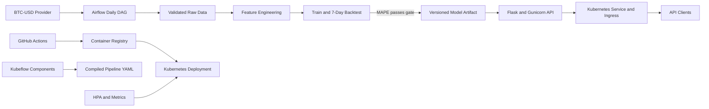

# Production Bitcoin Forecasting MLOps Platform

**Author:** Abdul Rehman  
**Roll number:** 24L-8010

This repository implements a production-oriented MLOps system that retrieves daily BTC-USD data,
creates leakage-safe time-series features, trains and gates a forecasting model, exposes forecasts
through a validated Flask API, orchestrates retraining with Airflow and Kubeflow, publishes a
container through GitHub Actions, and deploys it to Kubernetes with persistent storage, probes,
Ingress, and horizontal autoscaling.

## Architecture



## API contract

| Method | Endpoint | Purpose |
|---|---|---|
| GET | `/health` | Readiness status, uptime, and model version |
| POST | `/predict` | One-to-thirty-day forecast; default seven days |
| GET | `/metrics` | MAE, RMSE, MAPE, and validation interval |
| POST | `/internal/reload` | Token-protected artifact reload used by Airflow |

## Local model workflow

```powershell
python -m pip install -r requirements-dev.txt
python -m src.etl_fetch --period 5y
python -m src.train_forecast
pytest --cov=app --cov=src --cov-report=term-missing
python kubeflow/btc_kfp_pipeline.py     # compile to YAML
python kubeflow/run_local.py subprocess  # optional: execute locally (Linux/Docker)
```

The final seven observations are held out chronologically. The candidate is registered atomically
only when validation MAPE is at most 25 percent. Random splitting is avoided because it would leak
future information into a time-series evaluation.

## Docker Compose

```powershell
docker compose run --rm airflow-init
docker compose up -d
docker compose ps
```

Airflow is at `http://localhost:8080` with the demonstration account `admin/admin`. The API is at
`http://localhost:5000`. This password is for local demonstration only.

## Kubernetes

Replace the image and secret before deployment, then apply the manifests:

```powershell
kubectl apply -f k8s/namespace.yaml
kubectl apply -f k8s/configmap-secret.yaml
kubectl apply -f k8s/pvc.yaml
kubectl apply -f k8s/deployment.yaml
kubectl apply -f k8s/service.yaml
kubectl apply -f k8s/hpa.yaml
kubectl apply -f k8s/ingress.yaml
kubectl -n btc-forecast rollout status deployment/btc-forecast-api
kubectl -n btc-forecast get pods,svc,pvc,hpa,ingress
```

### Autoscaling evidence

```powershell
kubectl -n btc-forecast get hpa --watch
locust -f loadtest/locustfile.py --host http://localhost:30080
```

Capture the HPA before load, Locust statistics during load, and HPA after replicas increase.

### Self-healing evidence

```powershell
kubectl -n btc-forecast get pods -w
kubectl -n btc-forecast delete pod <pod-name>
```

Capture the deletion and replacement pod with different names and timestamps in one terminal.

## CI/CD secrets

Configure `DOCKER_USERNAME` and `DOCKER_PASSWORD` in GitHub repository secrets. Pushes to `main`
run formatting, linting, tests, coverage, and Kubeflow compilation before publishing both
`sha-<commit>` and `latest` image tags.

## Security and reliability decisions

- Numeric non-root container user with dropped Linux capabilities.
- Kubernetes blocks privilege escalation and uses a read-only root filesystem.
- Secrets are injected at runtime rather than embedded in the image.
- Atomic model replacement prevents partially written artifacts.
- Readiness and liveness checks isolate unhealthy replicas.
- Airflow uses bounded retries, execution timeouts, and one active run.
- Model acceptance is controlled by a visible validation threshold.

## Submission evidence checklist

1. Passing tests and coverage summary.
2. Docker multi-stage build and running Compose services.
3. Health, prediction, validation-error, and metrics responses.
4. Airflow graph and successful task instances.
5. Compiled Kubeflow YAML.
6. Successful GitHub Actions jobs and registry tags.
7. Kubernetes pods, services, PVC, HPA, and Ingress.
8. Locust statistics and HPA scale-up.
9. Pod deletion followed by automatic replacement.
10. Live seven-day response through Kubernetes.

## Verified demonstration results

On 24 November 2026, the pipeline trained on 1,827 daily records and achieved a seven-day
chronological validation MAPE of 2.836 percent. The manually triggered Airflow DAG completed all
four tasks successfully. A 90-second Locust run generated 3,927 requests and caused the HPA to
scale the API to its configured maximum of eight replicas at 252 percent observed CPU. Kubernetes
also replaced a deliberately deleted pod in approximately 14 seconds. Full values and evidence
references are recorded in `report/evidence_log.md`.

