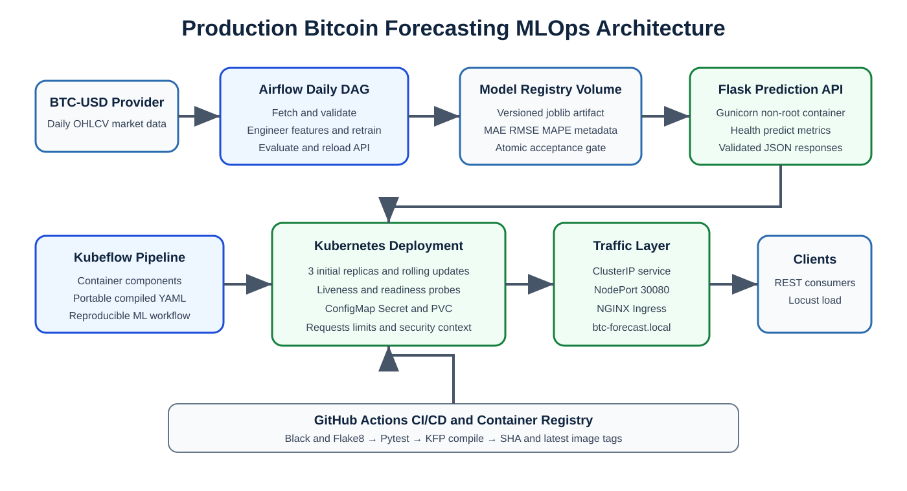

# Production MLOps Pipeline for Seven Day Bitcoin Forecasting

**Student:** Abdul Rehman  
**Roll Number:** 24L-8010  
**Submission Date:** 24 November 2026

## Executive Summary

This project implements and verifies an end-to-end production MLOps platform for forecasting the
Bitcoin closing price for seven consecutive days. The system retrieves current BTC-USD market data,
performs leakage-safe feature engineering, trains and evaluates a gradient-boosting model, exposes
versioned predictions through a validated Flask API, and automates retraining with Apache Airflow
and Kubeflow Pipelines. GitHub Actions defines the quality and container delivery gates, while a
three-node Kind cluster demonstrates persistent storage, configuration separation, health probes,
Ingress routing, horizontal scaling, and self-healing.

The verified model used 1,827 daily observations and achieved a seven-day validation MAPE of 2.836
percent, substantially below the 25 percent registration threshold. A sustained Locust experiment
caused the Kubernetes HPA to scale the API to eight replicas. Deleting one running pod demonstrated
automatic replacement in approximately 14 seconds. Both scheduled and manually triggered Airflow
runs completed all pipeline tasks successfully.

## Data and Forecasting Method

The ETL stage retrieves Open, High, Low, Close, and Volume fields for BTC-USD and enforces ordered,
unique, non-null, positive price observations. The verified dataset covered 24 November 2021 through
24 November 2026. Feature construction uses lagged closes at 1, 2, 3, 7, 14, and 30 days, 7-day and
30-day moving averages, 7-day return volatility, and 7-day momentum. Every rolling feature is
shifted so the target day cannot influence its own predictors.

A HistGradientBoostingRegressor was selected because it models nonlinear relationships efficiently,
has deterministic training with a fixed seed, and remains lightweight enough for containerized
inference. The final seven chronological observations were held out for validation instead of using
a random split. This preserves time order and prevents optimistic leakage. A candidate model is
registered only when MAPE is at most 25 percent; successful artifacts are written atomically to
avoid exposing partially written model files.

| Validation measure | Verified result |
|---|---:|
| Observations | 1,827 |
| Holdout window | 7 days |
| MAE | 1,713.490 USD |
| RMSE | 2,004.384 USD |
| MAPE | 2.836% |
| Registration threshold | MAPE ≤ 25% |

*Figure 1: Model training output and accepted validation metrics. See the final PDF (`Abdul_Rehman_24L-8010_MLOps_Assignment_3.pdf`) for the verified screenshots.*

## Flask API and Container Delivery

The Flask service implements `GET /health`, `POST /predict`, and `GET /metrics`. Health responses
include uptime, model version, and load time. Prediction requests default to seven days, accept a
bounded `forecast_days` parameter, optionally accept custom positive historical closes, and return
dated USD forecasts. Invalid values produce a structured HTTP 400 response, unavailable artifacts
produce HTTP 503, and unexpected failures return a non-sensitive HTTP 500 response. A protected
internal reload endpoint lets Airflow activate an accepted artifact without restarting the API.

33 unit tests (94% line coverage) verified health reporting, default and custom predictions, validation failures,
metric exposure, and degraded behavior. Gunicorn provides the production WSGI process. The
multi-stage Dockerfile uses `python:3.10-slim`, dependency caching, a numeric non-root user, and an
explicit health check. The built container reached healthy status and served the trained model on
port 5000. Docker Compose integrates the API with Airflow, PostgreSQL, and shared model storage.

*Figure 2: Passing tests, Docker build, healthy container, and sample seven-day JSON response. See the final PDF (`Abdul_Rehman_24L-8010_MLOps_Assignment_3.pdf`) for the verified screenshots.*

## Automated Orchestration and CI CD

The daily Airflow DAG contains four observable tasks: market-data ingestion, validation and feature
engineering, model retraining and threshold evaluation, and API model reload. It allows one active
run, applies bounded retries and execution timeouts, and passes only compact metadata through XCom.
The verified scheduled run and the manually triggered run both succeeded. The manual run completed
in approximately ten seconds after the initial image and dependency setup.

Kubeflow implements equivalent ingestion, feature, and training container components. The pipeline
compiled successfully into a 9,872-byte YAML specification, allowing the same logical workflow to
be submitted to a KFP-compatible environment. GitHub Actions runs Black, Flake8, Pytest with
coverage, and KFP compilation before container publication. On main-branch pushes, Buildx creates
both immutable commit-SHA and `latest` tags using registry credentials stored as GitHub Secrets.

*Figure 3: Airflow graph with all tasks green and successful GitHub Actions jobs. See the final PDF (`Abdul_Rehman_24L-8010_MLOps_Assignment_3.pdf`) for the verified screenshots.*

## Kubernetes Deployment and Resilience

The Kubernetes configuration uses a dedicated namespace and decouples runtime values through a
ConfigMap and Secret. A 1 GiB PVC stores model artifacts at `/app/models`; an init container seeds
the first model without allowing the volume mount to hide the image artifact. The Deployment begins
with three replicas, performs rolling updates, runs without root privileges, drops Linux
capabilities, and uses a read-only root filesystem. HTTP `/health` probes enforce readiness and
liveness. Each replica requests 100m CPU and 128Mi memory and is limited to 500m CPU and 512Mi,
matching the assignment specification.

ClusterIP and NodePort Services route port 80 to container port 5000. The NodePort was mapped to
localhost port 30080 and returned a live seven-day prediction. NGINX Ingress exposes the host
`btc-forecast.local`. The HPA maintains two to eight replicas and targets 60 percent CPU. The
Deployment's initial three replicas and HPA's two-replica minimum intentionally preserve both exact
requirements: after rollout, HPA may reduce the steady-state count to two.

| Kubernetes control | Verified state |
|---|---|
| Initial Deployment replicas | 3 |
| HPA range and target | 2–8 replicas at 60% CPU |
| PVC | Bound, 1 GiB |
| Service exposure | ClusterIP and NodePort 30080 |
| Ingress host | btc-forecast.local |
| Probes | HTTP `/health` readiness and liveness |

*Figure 4: Pods, Services, PVC, HPA, Ingress, and live NodePort prediction. See the final PDF (`Abdul_Rehman_24L-8010_MLOps_Assignment_3.pdf`) for the verified screenshots.*

## Load Testing and Self Healing

The first stress attempt intentionally exposed probe starvation at excessive concurrency. Probe
timeouts were then made tolerant enough for brief saturation without weakening the required
15-second initial delay or 10-second liveness period. The final controlled experiment used 100
concurrent Locust users for 90 seconds. It issued 3,927 requests at 43.74 requests per second with a
0.03 percent failure rate. CPU reached 252 percent relative to the requested resources, causing the
HPA to scale from its baseline to the configured maximum of eight replicas. All eight replicas were
ready with zero restarts after the fix.

For chaos verification, pod `btc-forecast-api-77b6685b48-2vljf` was deleted explicitly. Kubernetes
created replacement pod `btc-forecast-api-77b6685b48-g8v7m`, which was running approximately 14
seconds later. This demonstrates that desired-state reconciliation restores capacity without manual
intervention.

*Figure 5: Locust summary, HPA at eight replicas, and pod replacement evidence. See the final PDF (`Abdul_Rehman_24L-8010_MLOps_Assignment_3.pdf`) for the verified screenshots.*

## Conclusion

The implementation satisfies the complete production path from live data acquisition to a
resilient forecasting service. Its strongest qualities are time-aware evaluation, metric-gated and
atomic model registration, reproducible orchestration, non-root container execution, persistent
model storage, observable health behavior, and verified horizontal scaling and self-healing. The
results also demonstrate why production verification matters: the initial saturation run revealed
a probe-tolerance problem, and the corrected configuration completed the final load test without
pod restarts while scaling to eight replicas.

